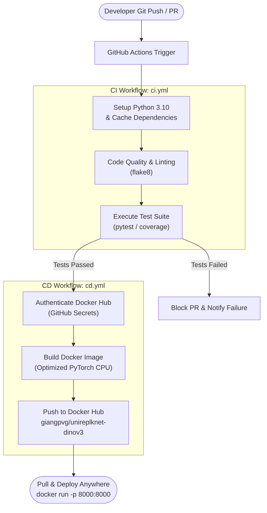

# UniRepLKNet with DINOv3 Backbone - AI Model Serving & CI/CD Pipeline

Production-grade AI inference serving microservice for **UniRepLKNet** integrated with **DINOv3 (Vision Transformer)** backbone for audio spectrogram classification. Fully containerized with **Docker** and automated via a dual-stage **CI/CD** pipeline with **GitHub Actions** publishing to **Docker Hub**.

---

## 1. System Architecture & CI/CD Pipeline Flow



---

## 2. Project Directory Structure

```text
.
├── .github/
│   └── workflows/
│       ├── ci.yml                # CI: Linting, syntax validation & pytest suite
│       └── cd.yml                # CD: Automated Docker build & push to Docker Hub
├── app/
│   ├── core/
│   │   ├── dinov3/               # DINOv3 ViT backbone architecture (Meta AI)
│   │   └── unireplknet_dinov3.py # UniRepLKNet model with DINOv3 backbone
│   ├── __init__.py
│   ├── main.py                   # FastAPI application & REST endpoints
│   ├── model.py                  # Model wrapper, inference service & fallback handler
│   └── schemas.py                # Pydantic schemas for request/response validation
├── tests/
│   ├── __init__.py
│   ├── test_api.py               # Integration tests for FastAPI endpoints
│   └── test_model.py             # Unit tests for model inference & preprocessing
├── weights/                      # Model checkpoints directory (mounted via volume)
│   └── .gitkeep
├── .dockerignore                 # Excluded build artifacts for minimal image size
├── .gitignore                    # Git tracking exclusions
├── Dockerfile                    # Production multi-stage Docker build (PyTorch CPU, non-root)
├── requirements.txt              # Core runtime dependencies
├── requirements-dev.txt          # Testing & development dependencies
└── README.md                     # Project documentation
```

---

## 3. Model Weights Management

The service includes an intelligent weights handling and fallback mechanism:

1. **CI / Test Mode (Default):** If the `./weights/` directory does not contain a pre-trained `.pth` or `.pt` checkpoint, the service automatically initializes the model with architectural untrained weights. This ensures that the CI/CD pipeline and Docker builds execute in under 30 seconds without network bottlenecks or heavy checkpoint downloads.
2. **Production Deployment:** When a trained checkpoint is available, simply drop the `.pth` file into `./weights/` or mount it at runtime via Docker volumes:
   ```bash
   docker run -d -p 8000:8000 -v ./weights:/app/weights --name ai-service giangpvg/unireplknet-dinov3:latest
   ```

---

## 4. Local Development & Testing

### 4.1. Environment Setup
Python 3.10 is recommended:
```bash
python3 -m venv .venv
source .venv/bin/activate
pip install --upgrade pip
pip install -r requirements.txt -r requirements-dev.txt
```

### 4.2. Run Automated Tests
```bash
pytest -v tests/
```

### 4.3. Start the API Server
```bash
uvicorn app.main:app --host 0.0.0.0 --port 8000 --reload
```
* **Interactive Swagger UI:** `http://localhost:8000/docs`
* **Liveness / Readiness Probe:** `http://localhost:8000/health`

---

## 5. Docker Containerization

### 5.1. Build Docker Image Locally
```bash
docker build -t giangpvg/unireplknet-dinov3:latest .
```

### 5.2. Run Container
```bash
docker run -d -p 8000:8000 --name ai-service giangpvg/unireplknet-dinov3:latest
```

Verify service availability:
```bash
curl http://localhost:8000/health
```

---

## 6. REST API Endpoints

### 6.1. `GET /health`
Liveness probe checking container status and execution device.
* **Response (200 OK):**
```json
{
  "status": "healthy",
  "device": "cpu",
  "weights_status": "untrained_weights (CI/test mode - ready for checkpoint)",
  "version": "1.0.0"
}
```

### 6.2. `GET /info`
Detailed metadata about the deployed AI model.
* **Response (200 OK):**
```json
{
  "model_name": "UniRepLKNet with DINOv3 Backbone",
  "backbone_arch": "dinov3_vits16",
  "in_channels": 1,
  "expected_input_shape": [1, 1, 128, 1024],
  "num_classes": 10,
  "classes": ["silence", "unknown", "yes", "no", "up", "down", "left", "right", "on", "off"],
  "weights_status": "untrained_weights (CI/test mode - ready for checkpoint)",
  "version": "1.0.0"
}
```

### 6.3. `POST /predict`
Executes audio spectrogram inference and classification.
* **Request Body (Synthetic testing):**
```json
{
  "use_synthetic": true
}
```
* **Request Body (Custom spectrogram):**
```json
{
  "spectrogram": [[0.5, 0.2, ...]],
  "use_synthetic": false
}
```
* **Response (200 OK):**
```json
{
  "status": "success",
  "prediction": {
    "predicted_label": "yes",
    "class_id": 2,
    "confidence": 0.188,
    "probabilities": {
      "silence": 0.089,
      "unknown": 0.0571,
      "yes": 0.188,
      "no": 0.126,
      "up": 0.0989,
      "down": 0.052,
      "left": 0.0735,
      "right": 0.118,
      "on": 0.143,
      "off": 0.0546
    }
  },
  "input_shape": [1, 1, 128, 1024],
  "latency_ms": 200.27
}
```

---

## 7. GitHub Actions CI/CD & Docker Hub Setup

The project uses two independent workflows located in `./.github/workflows/`:
* [`ci.yml`](./.github/workflows/ci.yml): Triggered on every `push` and `pull_request` targeting `main`, running flake8 linting and the pytest test suite.
* [`cd.yml`](./.github/workflows/cd.yml): Triggered upon successful completion of `ci.yml` on `main`, authenticating to Docker Hub, building the multi-platform image, and publishing it to [`giangpvg/unireplknet-dinov3`](https://hub.docker.com/repository/docker/giangpvg/unireplknet-dinov3/general).

### Configuring GitHub Repository Secrets:
1. Navigate to your GitHub Repository ➔ **Settings** ➔ **Secrets and variables** ➔ **Actions**.
2. Click **New repository secret** and configure:
   * `DOCKERHUB_USERNAME`: `giangpvg`
   * `DOCKERHUB_TOKEN`: Personal Access Token generated from Docker Hub (`dckr_pat_...`).
3. Commit and push changes to trigger the pipeline:
   ```bash
   git add .
   git commit -m "docs: update README to English"
   git push origin main
   ```
   GitHub Actions will automatically run tests, build the Docker container, and publish the image to Docker Hub.
