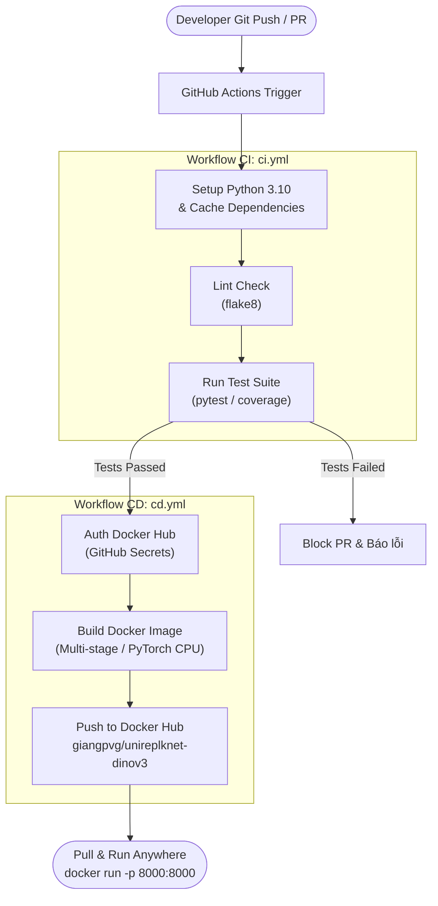

# UniRepLKNet with DINOv3 Backbone - AI Model Serving & CI/CD Pipeline

Dịch vụ phục vụ suy luận (AI Inference Serving) cho mô hình **UniRepLKNet** tích hợp backbone **DINOv3 (Vision Transformer)** cho bài toán phân loại âm thanh (Audio Spectrogram Classification), được đóng gói hoàn chỉnh bằng **Docker** và tự động hóa toàn diện với quy trình **CI/CD** qua **GitHub Actions** đẩy lên **Docker Hub**.

---

## 1. Kiến trúc luồng CI/CD (Pipeline Flow)



---

## 2. Cấu trúc thư mục dự án

```text
.
├── .github/
│   └── workflows/
│       ├── ci.yml                # Workflow CI: Linting & Unit/Integration Tests
│       └── cd.yml                # Workflow CD: Build & Push Image lên Docker Hub
├── app/
│   ├── core/
│   │   ├── dinov3/               # Thư viện backbone DINOv3 (Meta AI)
│   │   └── unireplknet_dinov3.py # Kiến trúc UniRepLKNet với DINOv3 backbone
│   ├── __init__.py
│   ├── main.py                   # FastAPI REST API endpoints
│   ├── model.py                  # Module bọc mô hình, xử lý weights & inference
│   └── schemas.py                # Pydantic schemas cho dữ liệu request/response
├── tests/
│   ├── __init__.py
│   ├── test_api.py               # Kiểm thử tích hợp các endpoint REST API
│   └── test_model.py             # Kiểm thử độ ổn định và suy luận của Model AI
├── weights/                      # Thư mục chứa file checkpoint (mount volume khi chạy)
│   └── .gitkeep
├── .dockerignore                 # Loại bỏ file rác để tối ưu kích thước image
├── Dockerfile                    # Kịch bản đóng gói container tối ưu (PyTorch CPU, non-root)
├── requirements.txt              # Thư viện runtime cho API & Model
├── requirements-dev.txt          # Thư viện cho CI/Testing (pytest, httpx, flake8)
└── README.md                     # Tài liệu hướng dẫn sử dụng
```

---

## 3. Quản lý trọng số (Weights Handling)

Mô hình hỗ trợ cơ chế nạp trọng số thông minh:
1. **Chế độ kiểm thử (CI/Test mode - Mặc định):** Nếu thư mục `./weights/` chưa có checkpoint, mô hình sẽ tự động khởi tạo với cấu hình Untrained/Random weights để phục vụ kiểm thử luồng suy luận. Pipeline CI/CD và Docker build sẽ chạy thành công 100% mà không bị phụ thuộc vào file checkpoint nặng.
2. **Chế độ triển khai thực tế (Production):** Khi bạn đã huấn luyện xong và có file checkpoint `.pth` hoặc `.pt`, bạn chỉ cần đặt file vào `./weights/` hoặc mount volume khi chạy container:
   ```bash
   docker run -d -p 8000:8000 -v ./weights:/app/weights --name ai-service giangpvg/unireplknet-dinov3:latest
   ```

---

## 4. Chạy và kiểm thử tại môi trường Local

### 4.1. Cài đặt môi trường
Khuyến nghị sử dụng Python 3.10:
```bash
python3 -m venv .venv
source .venv/bin/activate
pip install --upgrade pip
pip install -r requirements.txt -r requirements-dev.txt
```

### 4.2. Chạy bộ kiểm thử tự động
```bash
pytest -v tests/
```

### 4.3. Khởi chạy API Server
```bash
uvicorn app.main:app --host 0.0.0.0 --port 8000 --reload
```
* Tài liệu Swagger UI tương tác: `http://localhost:8000/docs`
* Kiểm tra sức khỏe hệ thống: `http://localhost:8000/health`

---

## 5. Đóng gói & Chạy bằng Docker

### 5.1. Build Docker Image
```bash
docker build -t giangpvg/unireplknet-dinov3:latest .
```

### 5.2. Chạy Container
```bash
docker run -d -p 8000:8000 --name ai-service giangpvg/unireplknet-dinov3:latest
```

Kiểm tra container đang hoạt động:
```bash
curl http://localhost:8000/health
```

---

## 6. Danh sách REST API Endpoints

### 6.1. `GET /health`
Kiểm tra trạng thái sẵn sàng của container và thông tin thiết bị.
* **Response (200 OK):**
```json
{
  "status": "healthy",
  "device": "cpu",
  "weights_status": "untrained_weights (CI/test mode - ready for checkpoint)",
  "version": "1.0.0"
}
```

### 6.2. `GET /info`
Trả về metadata chi tiết của mô hình AI.
* **Response (200 OK):**
```json
{
  "model_name": "UniRepLKNet with DINOv3 Backbone",
  "backbone_arch": "dinov3_vits16",
  "in_channels": 1,
  "expected_input_shape": [1, 1, 128, 1024],
  "num_classes": 10,
  "classes": ["silence", "unknown", "yes", "no", "up", "down", "left", "right", "on", "off"],
  "weights_status": "untrained_weights (CI/test mode - ready for checkpoint)",
  "version": "1.0.0"
}
```

### 6.3. `POST /predict`
Thực hiện suy luận dự đoán phân loại âm thanh từ spectrogram.
* **Request Body (Mô phỏng spectrogram mẫu):**
```json
{
  "use_synthetic": true
}
```
* **Response (200 OK):**
```json
{
  "status": "success",
  "prediction": {
    "predicted_label": "left",
    "class_id": 6,
    "confidence": 0.1619,
    "probabilities": {
      "silence": 0.0821,
      "unknown": 0.0915,
      "yes": 0.1042,
      "no": 0.0883,
      "up": 0.0954,
      "down": 0.1102,
      "left": 0.1619,
      "right": 0.0784,
      "on": 0.0921,
      "off": 0.0959
    }
  },
  "input_shape": [1, 1, 128, 1024],
  "latency_ms": 230.76
}
```

---

## 7. Cấu hình GitHub Actions CI/CD & Docker Hub

Dự án sử dụng 2 workflow độc lập trong `./.github/workflows/`:
* [`ci.yml`](./.github/workflows/ci.yml): Tự động kích hoạt trên mọi `push` và `pull_request`, chạy flake8 kiểm tra code và thực thi pytest.
* [`cd.yml`](./.github/workflows/cd.yml): Lắng nghe sự kiện `ci.yml` hoàn thành thành công trên nhánh `main`, đăng nhập vào Docker Hub, build image và push lên repository [`giangpvg/unireplknet-dinov3`](https://hub.docker.com/repository/docker/giangpvg/unireplknet-dinov3/general).

### Hướng dẫn cấu hình Secret trên GitHub Repository:
1. Truy cập vào GitHub Repository của bạn ➔ **Settings** ➔ **Secrets and variables** ➔ **Actions**.
2. Chọn **New repository secret** và thêm 2 secret:
   * `DOCKERHUB_USERNAME`: `giangpvg`
   * `DOCKERHUB_TOKEN`: Personal Access Token sinh ra từ tài khoản Docker Hub của bạn (dạng `dckr_pat_...`).
3. Đẩy code lên nhánh `main`:
   ```bash
   git add .
   git commit -m "feat: setup AI serving microservice with CI/CD"
   git push origin main
   ```
   GitHub Actions sẽ tự động thực hiện toàn bộ quy trình kiểm thử và phát hành image lên Docker Hub!
