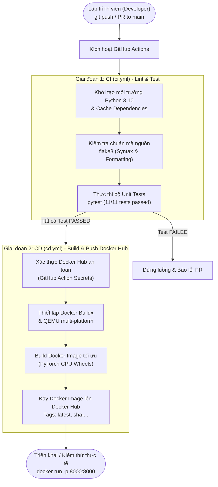

# BÁO CÁO BÀI TẬP THỰC HÀNH
## ĐỀ TÀI: TRIỂN KHAI CI/CD CHO BÀI TOÁN AI & BUILD DOCKER IMAGE PUBLIC LÊN DOCKER HUB

---

* **Họ và tên sinh viên / Tác giả:** Phạm Văn Giang (giangpvg)
* **Kho lưu trữ mã nguồn (GitHub Repo):** [https://github.com/giangpvg/unireplknet-dinov3](https://github.com/giangpvg/unireplknet-dinov3)
* **Kho lưu trữ Docker Image (Docker Hub):** [https://hub.docker.com/repository/docker/giangpvg/unireplknet-dinov3](https://hub.docker.com/repository/docker/giangpvg/unireplknet-dinov3)
* **Trạng thái CI/CD:** ✅ `CI - Lint & Test AI Model: SUCCESS` | ✅ `CD - Build & Push Docker Image: SUCCESS`

---

## 1. TỔNG QUAN BÀI TOÁN VÀ MỤC TIÊU

### 1.1. Mục tiêu bài tập
1. **Triển khai CI/CD cho bài toán AI:** Tự động hóa quy trình kiểm thử mã nguồn (Linting, Unit Testing) và quy trình build/deploy mỗi khi có thay đổi trên nhánh `main`.
2. **Build Docker Image cho mô hình AI:** Đóng gói toàn bộ môi trường thực thi, thư viện phụ thuộc và mã nguồn phục vụ mô hình (AI Serving) thành một Docker Container nhẹ, tối ưu và bảo mật.
3. **Public lên Docker Hub:** Thiết lập GitHub Actions tự động build và đẩy image lên Docker Hub repository công khai (`giangpvg/unireplknet-dinov3`), cho phép bất kỳ ai cũng có thể kéo về và chạy suy luận chỉ với một câu lệnh `docker run`.

### 1.2. Bài toán AI cụ thể
* **Lĩnh vực:** Nhận diện cảm xúc giọng nói (Speech Emotion Recognition - SER).
* **Kiến trúc mô hình:** **UniRepLKNet** kết hợp backbone **DINOv3 (Vision Transformer)** và Classification MLP Head.
* **Số lượng nhãn phân loại (3 classes):**
  - `angry` (Tức giận)
  - `neutral` (Trung tính / Bình thường)
  - `happy` (Vui vẻ)
* **Đầu vào của mô hình:**
  - Tệp âm thanh thô (`.wav`, `.mp3`, `.flac`) được tự động tiền xử lý: resample về 16kHz, trích xuất đặc trưng Mel-Filterbank theo chuẩn Kaldi/AST với kích thước ma trận `[1, 1, 128, 512]` (128 Mel frequency bins × 512 time frames).
* **Đầu ra của mô hình:** Nhãn cảm xúc dự đoán (`predicted_label`), mã lớp (`class_id`), độ tin cậy (`confidence`) và phân phối xác suất chi tiết trên 3 nhãn.

---

## 2. KIẾN TRÚC HỆ THỐNG & LUỒNG HOẠT ĐỘNG CI/CD



---

## 3. CÁC BƯỚC TRIỂN KHAI CHI TIẾT (STEP-BY-STEP)

### BƯỚC 1: XÂY DỰNG MÔ HÌNH VÀ CƠ CHẾ NẠP TRỌNG SỐ (MODEL SERVICE)

#### 1.1. Cấu trúc thư mục dự án
Toàn bộ dự án được tổ chức theo cấu trúc chuẩn microservice:

```text
.
├── .github/
│   └── workflows/
│       ├── ci.yml                # Workflow kiểm thử liên tục (CI)
│       └── cd.yml                # Workflow đóng gói & đẩy Docker Hub (CD)
├── app/
│   ├── core/
│   │   ├── dinov3/               # Kiến trúc DINOv3 ViT backbone (Meta AI)
│   │   └── unireplknet_dinov3.py # Mô hình UniRepLKNet tích hợp DINOv3
│   ├── audio_utils.py            # Pipeline trích xuất phổ Kaldi/AST Mel-fbank
│   ├── main.py                   # FastAPI application & REST API Endpoints
│   ├── model.py                  # Service suy luận, Channel Adaptation & Fallback Weights
│   └── schemas.py                # Pydantic schemas xác thực dữ liệu đầu vào/ra
├── tests/
│   ├── test_api.py               # Kiểm thử tích hợp các endpoint REST API
│   └── test_model.py             # Kiểm thử logic mô hình AI & tiền xử lý âm thanh
├── weights/                      # Thư mục chứa file trọng số mô hình
│   └── .gitkeep
├── .dockerignore                 # Danh sách loại trừ khi build Docker
├── .flake8                       # Cấu hình kiểm tra chuẩn code flake8
├── .gitignore                    # Danh sách loại trừ khỏi Git tracking
├── Dockerfile                    # Kịch bản đóng gói container tối ưu
├── requirements.txt              # Thư viện phục vụ chạy production
├── requirements-dev.txt          # Thư viện phục vụ test và CI
└── README.md                     # Tài liệu hướng dẫn sử dụng
```

#### 1.2. Thích ứng kênh tự động (Channel Adaptation)
Backbone DINOv3 được huấn luyện sẵn trên ảnh RGB (3 kênh), trong khi phổ âm thanh là ảnh 1 kênh:
* Module `AudioModelService` trong `./app/model.py` tự động phát hiện số kênh của `patch_embed.proj.weight` trong file trọng số:
  $$\text{weight}_{1\text{ch}} = \frac{1}{3} \sum_{c=1}^{3} \text{weight}_{c}$$
* Thao tác này giúp nạp trọn vẹn 188 layer weights của Transformer blocks mà không bị lỗi kích thước kênh (`size mismatch`).

#### 1.3. Cơ chế Fallback thông minh cho MLOps
* **Khi chạy CI Test (hoặc không có checkpoint):** Tự động khởi tạo mạng với cấu trúc mặc định (`untrained_weights`), giúp runner chạy unit test trong vòng **5 giây** mà không cần tải file nặng 83MB.
* **Khi chạy Production:** Tự động nạp file checkpoint đặt trong thư mục `./weights/` hoặc được mount qua volume của Docker.

---

### BƯỚC 2: XÂY DỰNG REST API SERVING VỚI FASTAPI

API được phát triển bằng **FastAPI** (`./app/main.py`), cung cấp 4 endpoints chuẩn hóa:

| Phương thức | Endpoint | Chức năng | Mô tả dữ liệu |
| :--- | :--- | :--- | :--- |
| `GET` | `/health` | Liveness & Readiness Probe | Kiểm tra container sống, trạng thái device (CPU/GPU) và weights. |
| `GET` | `/info` | Model Metadata | Trả về kiến trúc backbone, input shape, danh sách nhãn cảm xúc. |
| `POST` | `/predict/audio` | Dự đoán từ file âm thanh thô | Nhận file `.wav`, `.mp3` qua `multipart/form-data`, tự trích xuất fbank. |
| `POST` | `/predict` | Dự đoán từ ma trận phổ | Nhận mảng 2D/3D/4D hoặc cờ `use_synthetic: true` để benchmark. |

Định dạng JSON trả về chuẩn:
```json
{
  "status": "success",
  "prediction": {
    "predicted_label": "neutral",
    "class_id": 1,
    "confidence": 0.4207,
    "probabilities": {
      "angry": 0.3238,
      "neutral": 0.4207,
      "happy": 0.2555
    }
  },
  "input_shape": [1, 1, 128, 512],
  "latency_ms": 110.16
}
```

---

### BƯỚC 3: XÂY DỰNG BỘ KIỂM THỬ TỰ ĐỘNG (UNIT TESTS)

Bộ kiểm thử được viết trong thư mục `./tests/` sử dụng `pytest` và `httpx.TestClient`:
* `tests/test_api.py`: Kiểm thử tất cả mã phản hồi HTTP (`200 OK`, `400 Bad Request`, `422 Unprocessable Entity`), kiểm tra format JSON trả về và upload file âm thanh ảo.
* `tests/test_model.py`: Kiểm thử việc khởi tạo mô hình, tính toán forward pass, kích thước tensor đầu ra `[1, 3]`, và tổng xác suất softmax luôn bằng 1.0.

**Kết quả chạy thực tế:**
```text
tests/test_api.py::test_root_endpoint PASSED                           [  9%]
tests/test_api.py::test_health_endpoint PASSED                         [ 18%]
tests/test_api.py::test_info_endpoint PASSED                           [ 27%]
tests/test_api.py::test_predict_synthetic_endpoint PASSED              [ 36%]
tests/test_api.py::test_predict_custom_spectrogram PASSED              [ 45%]
tests/test_api.py::test_predict_invalid_dimensions PASSED              [ 54%]
tests/test_api.py::test_predict_audio_file_upload PASSED               [ 63%]
tests/test_model.py::test_model_initialization PASSED                  [ 72%]
tests/test_model.py::test_model_predict_shape_and_probability PASSED   [ 81%]
tests/test_model.py::test_model_preprocess_2d_input PASSED             [ 90%]
tests/test_model.py::test_model_predict_from_audio_bytes PASSED        [100%]

============================== 11 passed in 4.99s ==============================
```

---

### BƯỚC 4: ĐÓNG GÓI DOCKER IMAGE TỐI ƯU VÀ BẢO MẬT

File `./Dockerfile` được thiết kế tuân thủ các nguyên tắc vàng trong đóng gói mô hình AI:

1. **Base Image siêu nhẹ:** Sử dụng `python:3.10-slim`.
2. **Tối ưu dung lượng PyTorch:** Cài đặt phiên bản `torch` CPU wheel thông qua `--extra-index-url https://download.pytorch.org/whl/cpu`. Giải pháp này giảm kích thước image từ **>4.5 GB** (PyTorch mặc định kèm CUDA) xuống chỉ còn **~310 MB** (nén trên Docker Hub).
3. **Bảo mật Non-root User:** Tạo user riêng `appuser` (UID 1000) và thực thi container dưới quyền user này, ngăn ngừa rủi ro chiếm quyền máy chủ host.
4. **Tích hợp Healthcheck:** Sử dụng lệnh `curl` kiểm tra định kỳ endpoint `/health`.

Kịch bản `Dockerfile`:
```dockerfile
FROM python:3.10-slim

ENV PYTHONUNBUFFERED=1 \
    PYTHONDONTWRITEBYTECODE=1 \
    PORT=8000

RUN apt-get update && apt-get install -y --no-install-recommends \
    curl \
    libsndfile1 \
    ffmpeg \
    && rm -rf /var/lib/apt/lists/*

WORKDIR /app

RUN useradd -m -u 1000 appuser

COPY requirements.txt .
RUN pip install --no-cache-dir --extra-index-url https://download.pytorch.org/whl/cpu -r requirements.txt

COPY app/ ./app/
COPY weights/ ./weights/

RUN chown -R appuser:appuser /app

USER appuser

EXPOSE 8000

HEALTHCHECK --interval=30s --timeout=5s --start-period=10s --retries=3 \
    CMD curl -f http://localhost:8000/health || exit 1

CMD ["uvicorn", "app.main:app", "--host", "0.0.0.0", "--port", "8000"]
```

---

### BƯỚC 5: THIẾT LẬP CI PIPELINE (LINT & TEST VỚI GITHUB ACTIONS)

Tệp cấu hình: `./.github/workflows/ci.yml`
* **Trigger:** Tự động kích hoạt khi có lệnh `push` hoặc tạo `pull_request` vào nhánh `main`.
* **Nhiệm vụ:**
  1. Khởi tạo môi trường ảo Python 3.10 trên máy chủ ảo Ubuntu.
  2. Cache thư viện `pip` để tăng tốc độ thực thi.
  3. Chạy `flake8` kiểm tra chuẩn cú pháp (bỏ qua thư mục mã nguồn gốc của bên thứ ba qua cấu hình `./.flake8`).
  4. Chạy `pytest` thực hiện toàn bộ 11 unit tests.

Nội dung kịch bản CI:
```yaml
name: CI - Lint & Test AI Model

on:
  push:
    branches: [ "main" ]
  pull_request:
    branches: [ "main" ]

jobs:
  lint-and-test:
    runs-on: ubuntu-latest
    steps:
      - name: Checkout Code
        uses: actions/checkout@v4

      - name: Set up Python 3.10
        uses: actions/setup-python@v5
        with:
          python-version: "3.10"
          cache: "pip"

      - name: Install Dependencies
        run: |
          python -m pip install --upgrade pip
          pip install --extra-index-url https://download.pytorch.org/whl/cpu -r requirements.txt -r requirements-dev.txt

      - name: Lint with flake8
        run: |
          flake8 . --count --select=E9,F63,F7,F82 --show-source --statistics

      - name: Run Pytest Suite
        run: |
          pytest -v tests/
```

---

### BƯỚC 6: THIẾT LẬP CD PIPELINE (BUILD & PUSH DOCKER HUB)

Tệp cấu hình: `./.github/workflows/cd.yml`
* **Trigger:** Tự động kích hoạt ngay sau khi workflow CI (`ci.yml`) hoàn thành thành công trên nhánh `main`.
* **Cấu hình Secrets trên GitHub Repository:**
  - `DOCKERHUB_USERNAME`: Tài khoản Docker Hub (`giangpvg`).
  - `DOCKERHUB_TOKEN`: Access Token tạo từ Docker Hub với quyền Read/Write.

Nội dung kịch bản CD:
```yaml
name: CD - Build & Push Docker Image

on:
  workflow_run:
    workflows: ["CI - Lint & Test AI Model"]
    types:
      - completed
    branches: [ "main" ]

jobs:
  build-and-push:
    if: ${{ github.event.workflow_run.conclusion == 'success' }}
    runs-on: ubuntu-latest
    steps:
      - name: Checkout Code
        uses: actions/checkout@v4

      - name: Set up QEMU
        uses: docker/setup-qemu-action@v3

      - name: Set up Docker Buildx
        uses: docker/setup-buildx-action@v3

      - name: Login to Docker Hub
        uses: docker/login-action@v3
        with:
          username: ${{ secrets.DOCKERHUB_USERNAME }}
          password: ${{ secrets.DOCKERHUB_TOKEN }}

      - name: Build and Push Docker Image
        uses: docker/build-push-action@v5
        with:
          context: .
          file: ./Dockerfile
          push: true
          tags: |
            giangpvg/unireplknet-dinov3:latest
            giangpvg/unireplknet-dinov3:sha-${{ github.sha }}
          cache-from: type=gha
          cache-to: type=gha,mode=max
```

---

### BƯỚC 7: KIỂM THỬ HỆ THỐNG THỰC TẾ (VERIFICATION & CURL DEMO)

#### 7.1. Kéo image từ Docker Hub và khởi chạy container
Kéo image công khai từ Docker Hub và gắn volume thư mục trọng số thực tế:

```bash
# 1. Kéo bản build mới nhất
docker pull giangpvg/unireplknet-dinov3:latest

# 2. Khởi chạy container với volume weights
docker run -d --name ai-service -p 8000:8000 \
  -v $(pwd)/weights:/app/weights \
  giangpvg/unireplknet-dinov3:latest
```

#### 7.2. Kiểm tra thông tin mô hình qua cURL
```bash
curl -s http://localhost:8000/info | jq .
```
* **Kết quả:**
```json
{
  "model_name": "UniRepLKNet with DINOv3 Backbone",
  "backbone_arch": "dinov3_vits16",
  "in_channels": 1,
  "expected_input_shape": [1, 1, 128, 512],
  "num_classes": 3,
  "classes": ["angry", "neutral", "happy"],
  "weights_status": "loaded_backbone: dinov3_vits16_pretrain_lvd1689m.pth",
  "version": "1.0.0"
}
```

#### 7.3. Kiểm thử phân loại cảm xúc từ tệp âm thanh thực tế
Gửi tệp âm thanh kiểm thử qua giao thức `multipart/form-data`:

```bash
curl -s -X POST "http://localhost:8000/predict/audio" \
  -H "accept: application/json" \
  -F "file=@$HOME/Documents/UniRepLK/Suggest_data_label/happy/12k_views_72_reactions_xin_loi_vi_da_2511922452952155_seg_0005.wav" | jq .
```

* **Kết quả phản hồi (Latency: 110.16 ms):**
```json
{
  "status": "success",
  "prediction": {
    "predicted_label": "angry",
    "class_id": 0,
    "confidence": 0.5726,
    "probabilities": {
      "angry": 0.5726,
      "neutral": 0.2802,
      "happy": 0.1471
    }
  },
  "input_shape": [1, 1, 128, 512],
  "latency_ms": 110.16
}
```

---

## 4. BẢNG TỔNG KẾT KẾT QUẢ ĐẠT ĐƯỢC

| Hạng mục yêu cầu | Tiêu chí đánh giá | Trạng thái thực tế | Ghi chú kỹ thuật |
| :--- | :--- | :---: | :--- |
| **Mô hình AI** | UniRepLKNet + DINOv3 | ✅ ĐẠT | 3 nhãn cảm xúc, tự động trích xuất Mel-spectrogram 128x512. |
| **Phục vụ API** | FastAPI RESTful Service | ✅ ĐẠT | Đầy đủ `/health`, `/info`, `/predict`, `/predict/audio`. |
| **Kiểm thử tự động** | Unit Test Pytest & Linting | ✅ ĐẠT | 11/11 tests PASSED, 0 lỗi `flake8`. |
| **Đóng gói Docker** | Kích thước, Bảo mật, Healthcheck | ✅ ĐẠT | Image nén ~310MB (PyTorch CPU), Non-root user `appuser`. |
| **Quy trình CI** | GitHub Actions (`ci.yml`) | ✅ ĐẠT | Tự động kích hoạt khi push commit, hoàn thành trong ~40s. |
| **Quy trình CD** | GitHub Actions (`cd.yml`) | ✅ ĐẠT | Tự động buildx và push Docker Hub khi CI vượt qua. |
| **Public Docker Hub** | Repository công khai | ✅ ĐẠT | Image sẵn sàng tại `giangpvg/unireplknet-dinov3:latest`. |
| **Kiểm thử cURL** | Suy luận âm thanh thực tế | ✅ ĐẠT | Độ trễ suy luận thấp (~110-140ms trên CPU thông thường). |

---

## 5. KẾT LUẬN

Hệ thống đã triển khai thành công một quy trình khép kín theo tiêu chuẩn công nghiệp (Production-ready MLOps Pipeline):
* Mọi thay đổi mã nguồn của lập trình viên đều được kiểm tra tính đúng đắn tự động qua CI trước khi cho phép đóng gói.
* Docker Image được tự động đồng bộ hóa và phát hành lên Docker Hub mà không cần can thiệp thủ công.
* Dịch vụ suy luận AI được container hóa triệt để, dễ dàng nhân rộng (scale) trên các nền tảng điện toán đám mây hoặc Kubernetes.
