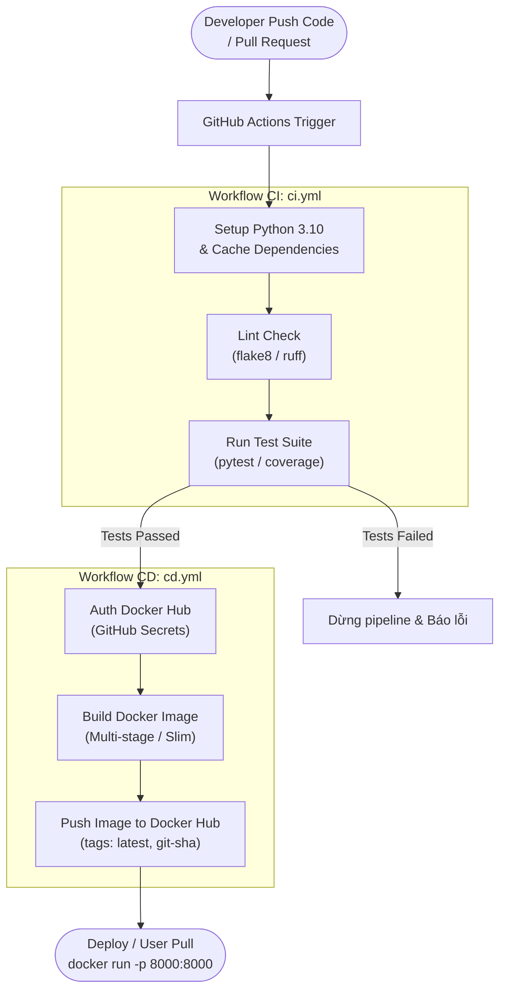

### 1. Kiến trúc luồng CI/CD (Pipeline Flow)



---

### 2. Cấu trúc thư mục dự kiến (`<project_root>`)

Toàn bộ mã nguồn sẽ được tổ chức theo cấu trúc chuẩn module hóa phục vụ kiểm thử và đóng gói:

```text
.
├── .github/
│   └── workflows/
│       ├── ci.yml                # Workflow CI: Linting & Unit/Integration Tests
│       └── cd.yml                # Workflow CD: Build Docker Image & Push Docker Hub
├── app/
│   ├── __init__.py
│   ├── main.py                   # FastAPI service cung cấp REST API (health, predict)
│   ├── model.py                  # Module nạp trọng số & xử lý inference cho Model AI
│   └── schemas.py                # Định nghĩa dữ liệu đầu vào/ra (Pydantic validation)
├── tests/
│   ├── __init__.py
│   ├── test_api.py               # Kiểm thử API endpoints (/health, /predict)
│   └── test_model.py             # Kiểm thử độ ổn định, shape output của model
├── weights/                      # Tạm thời để trống (.gitkeep), mount checkpoint thật khi chạy
├── .dockerignore                 # Loại bỏ rác build, cache, env để tối ưu kích thước image
├── Dockerfile                    # Kịch bản đóng gói container (Python slim, non-root user)
├── requirements.txt              # Thư viện runtime cho API & Model
├── requirements-dev.txt          # Thư viện cho CI/Testing (pytest, httpx, flake8)
└── README.md                     # Hướng dẫn chi tiết chạy local & pull từ Docker Hub
```

---

### 3. Các giai đoạn triển khai chi tiết

#### Giai đoạn 1: Chuẩn bị Model AI & API Serving (`app/`)
* **Framework:** Sử dụng **FastAPI** và **Uvicorn** vì tốc độ cao, hỗ trợ kiểm tra kiểu dữ liệu tự động với Pydantic và sinh tài liệu Swagger UI tự động tại `/docs`.
* **Endpoints:**
  * `GET /health`: Endpoint kiểm tra trạng thái container và sẵn sàng phục vụ (Liveness/Readiness probe).
  * `GET /info`: Trả về metadata của model (tên phiên bản, framework, input/output shape, trạng thái weights).
  * `POST /predict`: Nhận dữ liệu (file âm thanh/ảnh/vector số), tiền xử lý, thực hiện inference và trả kết quả JSON chuẩn hóa.
* **Cơ chế quản lý Trọng số (Weights Handling - Tạm thời để trống):**
  * Thư mục `weights/` sẽ tạm thời để trống và chỉ chứa file placeholder `.gitkeep` để Git lưu vết thư mục.
  * Trong `app/model.py`, thiết lập cơ chế fallback thông minh:
    * Nếu tìm thấy file trọng số trong `weights/` (hoặc biến môi trường `MODEL_WEIGHTS_PATH`), model sẽ load checkpoint thật.
    * Nếu thư mục `weights/` trống, model sẽ tự động khởi tạo kiến trúc (`UniRepLKNet` + `DINOv3`) với trọng số khởi tạo ban đầu (Untrained/Random Initialization) để phục vụ kiểm thử luồng suy luận. Điều này giúp pipeline CI/CD chạy thành công 100% mà không bị phụ thuộc vào file checkpoint nặng.
    * Khi sau này bạn đã train xong checkpoint, chỉ cần thả file vào `weights/` hoặc mount volume (`-v ./weights:/app/weights`) khi chạy Docker là hệ thống tự nhận diện mà không cần sửa code hay build lại image.

#### Giai đoạn 2: Thiết lập kiểm thử tự động (`tests/`)
* **Unit Testing:**
  * `test_model.py`: Kiểm tra hàm nạp mô hình, định dạng tensor đầu vào và shape/giá trị đầu ra.
* **Integration Testing:**
  * `test_api.py`: Sử dụng `fastapi.testclient.TestClient` để kiểm tra toàn bộ luồng request/response, mã trạng thái HTTP (200, 422 khi dữ liệu sai).

#### Giai đoạn 3: Đóng gói Container với Dockerfile tối ưu
* **Base Image:** Dùng `python:3.10-slim` để giảm dung lượng image tối đa (thay vì dùng full Ubuntu/Debian nặng nề).
* **Docker Cache:** Tách riêng lệnh `COPY requirements.txt` và `RUN pip install` trước khi copy mã nguồn nhằm tận dụng triệt để layer caching khi build lặp lại.
* **Bảo mật:** Tạo user non-root riêng (`appuser`) trong container, không chạy bằng quyền `root`.
* **Tối ưu `.dockerignore`:** Loại bỏ `.git`, `__pycache__`, `.venv`, các thư mục tạm và file nhạy cảm (`.env`).

#### Giai đoạn 4: Xây dựng Pipeline CI & CD riêng biệt (`.github/workflows/`)
* **File 1 — `ci.yml` (Continuous Integration):**
  * **Trigger:** Chạy khi có `pull_request` hoặc `push` trên các nhánh (`main`, `develop`, feature branches).
  * **Nhiệm vụ:**
    * Khởi tạo môi trường Ubuntu runner & Python 3.10.
    * Cache pip dependencies để tăng tốc chạy pipeline.
    * Chạy kiểm tra cú pháp và chuẩn code với `flake8`.
    * Chạy toàn bộ test suite với `pytest` (test model và test endpoints).
* **File 2 — `cd.yml` (Continuous Delivery):**
  * **Trigger:** Chạy khi `ci.yml` chạy thành công trên nhánh `main` (`workflow_run`), hoặc khi merge/push vào `main`, hỗ trợ cả trigger thủ công (`workflow_dispatch`).
  * **Nhiệm vụ:**
    * Đăng nhập an toàn vào Docker Hub qua GitHub Secrets (`DOCKERHUB_USERNAME`, `DOCKERHUB_TOKEN`).
    * Thiết lập Docker Buildx để build image tối ưu.
    * Build Docker image cho Model AI.
    * Đẩy (push) image lên Docker Hub với các tag (`latest`, `${{ github.sha }}`).

#### Giai đoạn 5: Hướng dẫn cấu hình Secret & Kiểm thử nghiệm thu
* Cung cấp hướng dẫn từng bước cấu hình 2 secrets trên GitHub repo:
  * `DOCKERHUB_USERNAME`: Tài khoản Docker Hub.
  * `DOCKERHUB_TOKEN`: Personal Access Token sinh ra từ Docker Hub (bảo mật hơn dùng mật khẩu trực tiếp).
* Hướng dẫn chạy thử nghiệm local với lệnh:
  ```bash
  docker build -t <dockerhub_username>/<repo_name>:latest .
  docker run -d -p 8000:8000 --name ai-service <dockerhub_username>/<repo_name>:latest
  curl http://localhost:8000/health
  ```

---

### 4. Xác nhận phương án & Thông tin cần chuẩn bị
* **Mô hình AI:** Đã chốt tái sử dụng `UniRepLKNet + DINOv3` từ TH2. Tạm thời để trống thư mục `weights/` và khởi tạo mô hình bằng Untrained/Random weights để hoàn thiện và kiểm thử 100% pipeline CI/CD trước. Khi bạn có file checkpoint `.pth`, chỉ cần copy vào `weights/` là xong.
* **Tên Docker Hub Repository:**
  1. Docker Hub Username: `giangpvg`
  2. Tên Docker Repository: `unireplknet-dinov3` (URL: `https://hub.docker.com/repository/docker/giangpvg/unireplknet-dinov3/general`)
  3. Đường dẫn image đầy đủ: `giangpvg/unireplknet-dinov3:latest`
  4. Thông tin GitHub Secrets cần thiết:
     * `DOCKERHUB_USERNAME`: `giangpvg`
     * `DOCKERHUB_TOKEN`: `***` *(Lưu trực tiếp vào GitHub Repository Secrets, không để lộ trong file code/markdown)*
